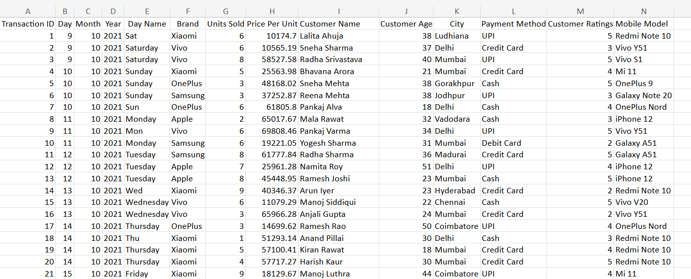
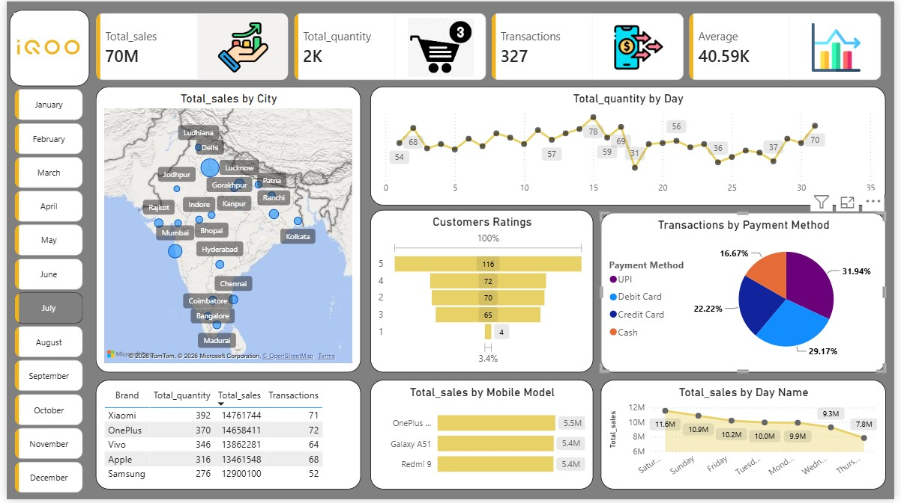

# Mobile Sales Analysis Dashboard | Power BI

## Objective

This project focuses on analyzing mobile sales data using Microsoft Power BI to evaluate sales performance, customer purchasing behavior, brand performance, and payment preferences.

The primary objective is to transform raw sales data into meaningful business insights by tracking key performance indicators (KPIs), analyzing geographical sales distribution, understanding customer ratings, and identifying sales trends across different mobile models and brands.

---

## Table of Contents

- [Dataset Used](#dataset-used)
- [Technologies Used](#technologies-used)
- [Project Workflow](#project-workflow)
- [Step 1: Data Overview](#step-1-data-overview)
- [Step 2: KPI Development](#step-2-kpi-development)
- [Step 3: Sales Performance Analysis](#step-3-sales-performance-analysis)
- [Step 4: Customer Ratings Analysis](#step-4-customer-ratings-analysis)
- [Step 5: Payment Method Analysis](#step-5-payment-method-analysis)
- [Step 6: Brand and Mobile Model Analysis](#step-6-brand-and-mobile-model-analysis)
- [Step 7: Geographical Sales Analysis](#step-7-geographical-sales-analysis)
- [Step 8: Dashboard](#step-8-dashboard)
- [Key Business Insights](#key-business-insights)

---

## Dataset Used

The dataset used in this project contains mobile sales transaction information, including sales amount, quantity sold, transaction details, mobile brands, mobile models, customer ratings, payment methods, transaction dates, and city information.

The dataset was used to analyze overall sales performance, customer preferences, and product-level business performance.

- **Dataset:**Mobile Sales Dataset
- **Format:** CSV / Excel
- **Source:** Online Resource

---

## Technologies Used

- **Microsoft Power BI:** Interactive Dashboard Development and Data Visualization
- **Power Query:** Data Cleaning and Transformation
- **DAX:** KPI Calculations and Business Metrics
- **Data Visualization:** Sales Trends, Customer Analysis, and Performance Reporting

---

## 🔄 Project Workflow

| Power Query | DAX | Power BI |
| :---: | :---: | :---: |
| Data Cleaning & Transformation | KPI Development & Calculations | Interactive Dashboard & Visualization |

---

## Step 1: Data Overview

In this step, the mobile sales dataset was loaded into Power BI to understand its structure, identify important columns, and examine the available transaction information.

The dataset includes information related to:

- Mobile Brands
- Mobile Models
- Sales Amount
- Quantity Sold
- Transaction Details
- Customer Ratings
- Payment Methods
- Transaction Dates
- City Information

The objective was to understand the dataset and prepare it for further analysis and dashboard development.

**Data Overview:**

---

## Step 2: KPI Development

Created key performance indicators (KPIs) to monitor overall mobile sales performance and provide a quick overview of business performance.

The following KPIs were developed:

| KPI | Value |
| :--- | ---: |
| Total Sales | 70M |
| Total Quantity | 2K |
| Transactions | 327 |
| Average Sales | 40.59K |

These KPIs provide an overview of total revenue, product sales volume, transaction activity, and average sales performance.

---

## Step 3: Sales Performance Analysis

Analyzed mobile sales performance across different days and months to identify sales trends and understand changes in customer purchasing behavior.

The analysis includes:

- Total Sales by Day Name
- Total Quantity by Day
- Monthly Sales Performance
- Sales Trend Analysis

The day-wise sales analysis helps identify high-performing and low-performing days.

---

## Step 4: Customer Ratings Analysis

Analyzed customer ratings to understand customer satisfaction and evaluate the distribution of ratings across different transactions.

The analysis includes:

- Customer Rating Distribution
- Number of Transactions by Rating
- Customer Feedback Analysis

This analysis helps understand customer satisfaction patterns and identify areas that may require improvement.

---

## Step 5: Payment Method Analysis

Analyzed transaction distribution across different payment methods to understand customer payment preferences.

The payment methods include:

- UPI
- Debit Card
- Credit Card
- Cash

The analysis helps identify the most commonly used payment methods and understand customer transaction behavior.

---

## Step 6: Brand and Mobile Model Analysis

Analyzed sales performance across different mobile brands and individual mobile models to identify top-performing products.

The analysis includes:

- Brand-wise Total Sales
- Brand-wise Quantity Sold
- Transactions by Brand
- Total Sales by Mobile Model

This analysis helps compare brand performance and identify mobile models contributing significantly to overall sales.

---

## Step 7: Geographical Sales Analysis

Analyzed geographical sales distribution across different cities using Power BI map visualization.

The analysis includes:

- Total Sales by City
- City-wise Sales Distribution
- Geographical Sales Performance

This visualization helps identify cities contributing to overall mobile sales and understand regional sales distribution.

---

## Step 8: Dashboard

Developed an interactive Power BI dashboard combining key performance indicators, sales trends, customer ratings, payment methods, brand performance, and geographical analysis.

The dashboard includes monthly slicers to enable users to explore sales performance across different months.

**Power BI Dashboard:**

---

## Key Business Insights

Based on the dashboard analysis:

1. Total sales reached approximately 70M across 327 transactions.
2. UPI accounted for the highest payment share at 31.94%.
3. Debit cards contributed 29.17% of total transactions.
4. Xiaomi recorded the highest quantity sold among the displayed brands.
5. Saturday recorded the highest sales among the displayed days.
6. OnePlus, Galaxy A51, and Redmi 9 were among the leading mobile models in the sales visualization.

---

## Project Outcome

Successfully developed an interactive Power BI dashboard to analyze mobile sales performance, customer preferences, payment trends, and brand-level performance.

The project demonstrates the practical application of Power BI, Power Query, DAX, KPI development, and business intelligence techniques to convert sales data into meaningful business insights.
